# Aula 2 · Documentação de projetos no Spring Boot


O objetivo desta aula é mostrar como configurar **Swagger UI** usando **Springdoc OpenAPI** no **Spring Boot** para documentar e testar sua API de forma simples.
Nesta aula, vamos definir o contrato HTTP do CRUD de produtos com DTOs, gerar a especificação OpenAPI e testar as cinco operações pelo Swagger UI.

**Pré-requisito**:
- [Projeto da Aula 1 · CRUD com Spring Boot](https://github.com/alonsodecarli/springboot-crud-h2/tree/9b0ee142e8c339352505a534e73aab9f2b7bcecf)


## O que é Swagger e OpenAPI 📖

### 🧭 Swagger

O **Swagger** começou como um **conjunto de ferramentas** para **descrever, gerar e consumir APIs REST**.

Hoje, o nome é usado principalmente para se referir a:

* **Swagger UI** → Interface web para visualizar e testar endpoints de uma API.
* **Swagger Editor** → Editor online para criar/manipular especificações.
* **Swagger Codegen** → Gera código cliente e servidor a partir de uma especificação.

> 💡 **Importante:** O formato de descrição que o Swagger usava evoluiu para se tornar o **OpenAPI Specification (OAS)**, mantido agora pela **OpenAPI Initiative**.


### 📜 OpenAPI

O **OpenAPI Specification (OAS)** é um **padrão** para **descrever APIs REST**.

Funciona como um **contrato** que define:

* 📍 **Endpoints** (ex.: `/api/produtos`)
* 🔄 **Métodos HTTP** (`GET`, `POST`, `PUT`, `DELETE`)
* 📨 **Parâmetros de entrada**
* 📦 **Estrutura das respostas**
* 🛑 **Códigos de status**

Pode ser escrito em **JSON** ou **YAML**.


* 📝 Exemplo simples em YAML

    ```yaml
    openapi: 3.0.3
    info:
    title: API de Produtos
    version: 1.0.0
    paths:
    /produtos:
        get:
        summary: Lista todos os produtos
        responses:
            '200':
            description: Lista retornada com sucesso
    ```


### 🛠 Springdoc OpenAPI

O **Springdoc OpenAPI** é uma biblioteca que simplifica a integração do Spring Boot com o OpenAPI. Ele gera automaticamente a documentação da API com base nas anotações do Spring e fornece uma interface Swagger UI para testar os endpoints.


### 💡 Resumo da relação

* 📜 **OpenAPI** → É o **padrão** (especificação).
* 🧭 **Swagger** → É o **conjunto de ferramentas** que implementa e facilita trabalhar com o padrão OpenAPI.
* ⚙️ **Springdoc OpenAPI** → É a **biblioteca** que integra Spring Boot e OpenAPI (e geralmente embute o Swagger UI).


### 🗓️ Linha do tempo resumida — Swagger e OpenAPI

* **2010 – Nasce o Swagger**

    * Criado por **Tony Tam**, o Swagger definia sua **própria especificação** para documentar APIs REST.
    * Junto com a especificação, foram criadas ferramentas como:

        * **Swagger UI**
        * **Swagger Editor**
        * **Swagger Codegen**

* **2015 – OpenAPI Initiative**

    * A especificação do Swagger foi **doada para a Linux Foundation** e se tornou **OpenAPI Specification (OAS)**.
    * A partir daí, o termo “Swagger” passou a se referir **apenas às ferramentas** e **não mais ao padrão**.


* **Hoje**

    * **Swagger** = Ferramentas (**UI, Editor, Codegen**)
    * **OpenAPI** = Padrão (**formato de contrato da API**)
    * No dia a dia, muitos devs ainda dizem **“Swagger”** para se referir à documentação, mesmo quando tecnicamente é **OpenAPI**.


💡 Ao adicionar essa dependência ao projeto, o **Springdoc OpenAPI** automaticamente configura e disponibiliza a documentação da sua API. Com isso, tanto o **gerador de especificação OpenAPI** quanto a interface interativa do **Swagger UI** estarão prontos para uso, sem necessidade de configurações adicionais.


## ⚙️ Configurando o Springdoc OpenAPI no projeto

Vamos usar como ponto de partida o projeto de CRUD implementado na Aula 1 como base para adicionar a documentação da API.

- [Projeto da Aula 1 · CRUD com Spring Boot](https://github.com/alonsodecarli/springboot-crud-h2/tree/9b0ee142e8c339352505a534e73aab9f2b7bcecf)


## 1️⃣ Entendendo o contrato da API

| Conceito | Papel no CRUD |
| --- | --- |
| **OpenAPI** | Especificação que descreve rotas, parâmetros, corpos de requisição, respostas e códigos HTTP em JSON ou YAML |
| **Springdoc OpenAPI** | Biblioteca que inspeciona controllers, tipos Java e anotações para gerar a especificação |
| **Swagger UI** | Interface web que lê a especificação e permite enviar requisições reais à aplicação |
| **DTO** (*Data Transfer Object*) | Tipo Java que representa os dados que cruzam a fronteira da API |

Se você acrescentar um campo interno à entidade JPA, pode manter o JSON público intacto deixando esse campo fora dos DTOs. No nosso CRUD, `ProdutoRequest` representa os campos que o cliente envia, e `ProdutoResponse` inclui também o `id` gerado pelo banco. O DTO é a forma Java desses dados. O *schema* OpenAPI é a descrição deles para quem consome a API.

## 2️⃣ Adicionando Springdoc e Bean Validation

Acrescente estas duas dependências dentro de `<dependencies>` no `pom.xml`. A versão do starter de validação é gerenciada pelo Spring Boot. 

```xml
<dependency>
    <groupId>org.springdoc</groupId>
    <artifactId>springdoc-openapi-starter-webmvc-ui</artifactId>
    <version>3.2.0</version>
</dependency>
<dependency>
    <groupId>org.springframework.boot</groupId>
    <artifactId>spring-boot-starter-validation</artifactId>
</dependency>
```

- segue a imagem ilustrando a adição das dependências no `pom.xml`.

    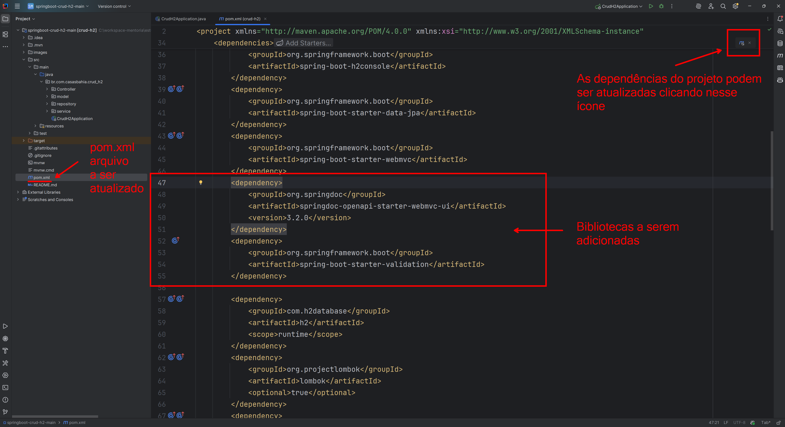


Com essas bibliotecas adicionadas em nosso projeto, ao executarmos novamente a aplicação já podemos acessar a Swagger UI:

- [Swagger UI: http://localhost:8080/swagger-ui/index.html](http://localhost:8080/swagger-ui.html)

    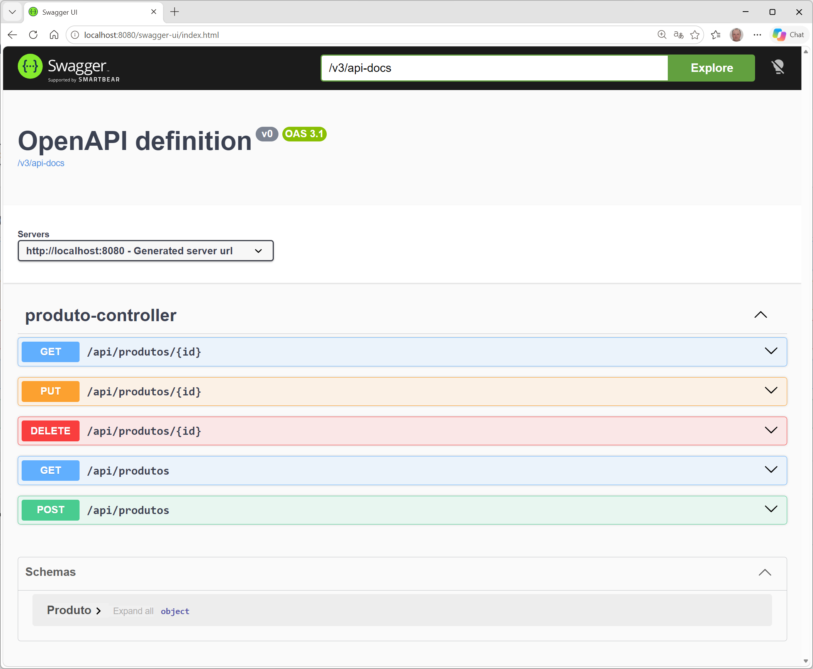


## 3️⃣ Criando os DTOs de produto

-- adicionar um conteúdo de referência sobre DTOs e validação.

DTOs (*Data Transfer Objects*) são usados para transportar dados entre camadas da aplicação, isolando a representação interna das entidades JPA da API pública. A validação com Jakarta Bean Validation garante que os dados recebidos atendam a regras específicas antes de serem processados, evitando inconsistências e erros.

Todos os caminhos Java daqui em diante partem de `src/main/java/br/com/casasbahia/crud_h2`. Os DTOs serão `record`, um tipo Java que fornece construtor e acessores a partir dos componentes declarados. `@Schema` descreve os campos no contrato. As anotações Jakarta Validation serão aplicadas no recebimento do JSON com `@Valid`.

Para a classe produto nossa aplicação exige nome, preço e quantidade. Preço e quantidade aceitam zero. NCM e descrição do NCM são opcionais. O NCM continua como `String` para preservar zeros à esquerda.

Crie ou substitua `dto/ProdutoRequest.java` no pacote base.

```java
package br.com.casasbahia.crud_h2.dto;

import io.swagger.v3.oas.annotations.media.Schema;
import jakarta.validation.constraints.NotBlank;
import jakarta.validation.constraints.NotNull;
import jakarta.validation.constraints.PositiveOrZero;

import java.math.BigDecimal;

@Schema(description = "Dados para criar ou atualizar um produto")
public record ProdutoRequest(
        @NotBlank @Schema(example = "Teclado USB") String nome,
        @Schema(example = "84716052") String ncm,
        @Schema(example = "Teclados") String descricaoNcm,
        @NotNull @PositiveOrZero @Schema(example = "89.90") BigDecimal preco,
        @NotNull @PositiveOrZero @Schema(example = "12") Integer quantidade
) {}
```
- Segue a imagem ilustrando o DTO de requisição.

    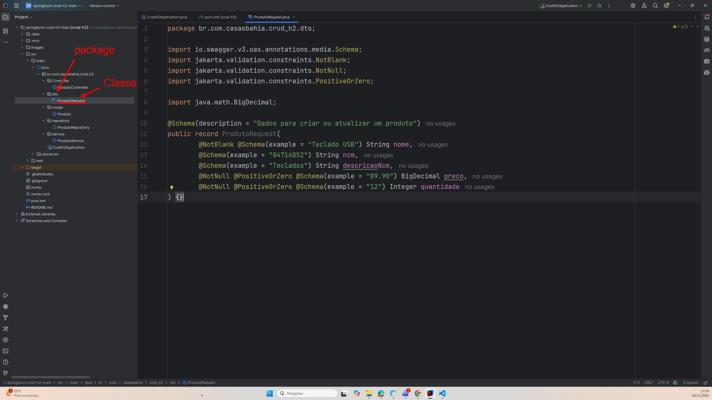


Crie ou substitua `dto/ProdutoResponse.java` no pacote base.

```java
package br.com.casasbahia.crud_h2.dto;

import io.swagger.v3.oas.annotations.media.Schema;
import java.math.BigDecimal;

@Schema(description = "Produto retornado pela API")
public record ProdutoResponse(
        @Schema(description = "Identificador gerado pelo banco", example = "1") Long id,
        @Schema(example = "Teclado USB") String nome,
        @Schema(example = "84716052") String ncm,
        @Schema(example = "Teclados") String descricaoNcm,
        @Schema(example = "89.90") BigDecimal preco,
        @Schema(example = "12") Integer quantidade
) {}
```
- segue a imagem ilustrando o DTO de resposta.

    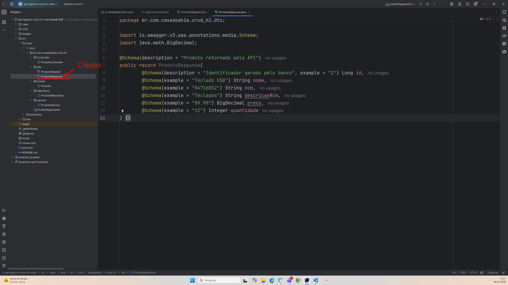


## Explicação das anotações utilizadas nos DTOs
Segue uma breve explicação sobre cada anotação utilizada nos DTOs:
- `@Schema`: fornece metadados para a documentação da API, como descrição e exemplo.
- `@NotBlank`: valida que a string não é nula e não está em branco.
- `@NotNull`: valida que o valor não é nulo.
- `@PositiveOrZero`: valida que o valor é positivo ou zero.

As anotações de validação (`@NotBlank`, `@NotNull`, `@PositiveOrZero`) são processadas pelo Spring Boot durante a validação dos DTOs de entrada.


## 4️⃣ Convertendo entre DTO e entidade

O mapper monta um `Produto` a partir do DTO de entrada. Na saída, ele seleciona os campos do produto persistido e monta o DTO de resposta. O controller vai usar o mapper antes de chamar o serviço e na hora de montar a resposta.

Crie ou substitua `mapper/ProdutoMapper.java` no pacote base.

```java
package br.com.casasbahia.crud_h2.mapper;

import br.com.casasbahia.crud_h2.dto.ProdutoRequest;
import br.com.casasbahia.crud_h2.dto.ProdutoResponse;
import br.com.casasbahia.crud_h2.model.Produto;
import org.springframework.stereotype.Component;

@Component
public class ProdutoMapper {

    public Produto toEntity(ProdutoRequest request) {
        return Produto.builder()
                .nome(request.nome())
                .ncm(request.ncm())
                .descricaoNcm(request.descricaoNcm())
                .preco(request.preco())
                .quantidade(request.quantidade())
                .build();
    }

    public ProdutoResponse toResponse(Produto produto) {
        return new ProdutoResponse(
                produto.getId(),
                produto.getNome(),
                produto.getNcm(),
                produto.getDescricaoNcm(),
                produto.getPreco(),
                produto.getQuantidade()
        );
    }
}
```

- Segue a imagem ilustrando o fluxo de conversão entre DTO e entidade.

    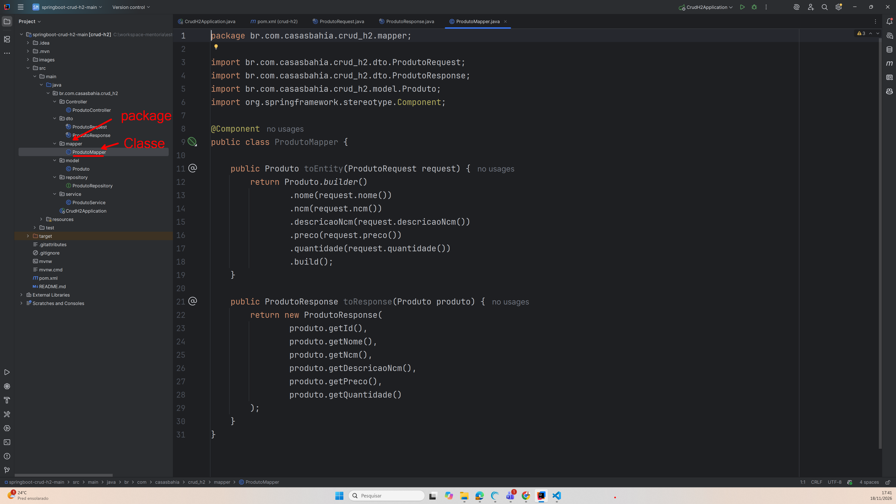


## 5️⃣ Fazendo o código responder com 404

Na Aula 1, buscar, atualizar ou excluir um ID inexistente lança uma `RuntimeException` genérica. Crie uma exceção específica para que o Spring MVC retorne `404 Not Found` nesses casos.

Crie ou substitua `exception/ProdutoNaoEncontradoException.java` no pacote base.

```java
package br.com.casasbahia.crud_h2.exception;

import org.springframework.http.HttpStatus;
import org.springframework.web.bind.annotation.ResponseStatus;

@ResponseStatus(HttpStatus.NOT_FOUND)
public class ProdutoNaoEncontradoException extends RuntimeException {

    public ProdutoNaoEncontradoException(Long id) {
        super("Produto não encontrado com o ID: " + id);
    }
}
```
- Segue a imagem ilustrando a exceção `ProdutoNaoEncontradoException`.

    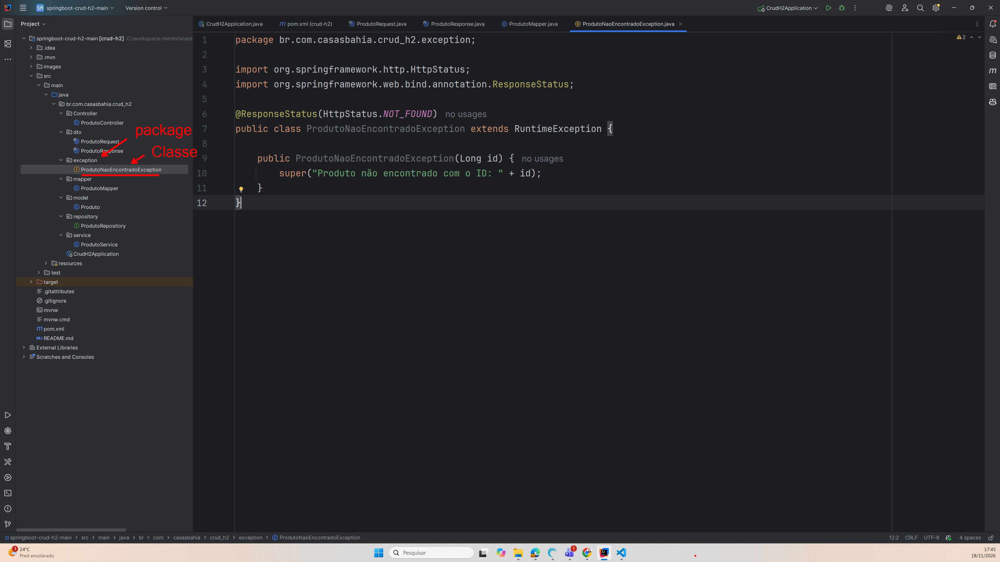


Em `service/ProdutoService.java`, importe `br.com.casasbahia.crud_h2.exception.ProdutoNaoEncontradoException` e troque as três ocorrências da exceção genérica:

| Método | Expressão nova |
| --- | --- |
| `buscarPorId` | `.orElseThrow(() -> new ProdutoNaoEncontradoException(id));` |
| `atualizar` | `throw new ProdutoNaoEncontradoException(produto.getId());` |
| `deletar` | `throw new ProdutoNaoEncontradoException(id);` |

```java
package br.com.casasbahia.crud_h2.service;

import br.com.casasbahia.crud_h2.exception.ProdutoNaoEncontradoException;
import br.com.casasbahia.crud_h2.model.Produto;
import br.com.casasbahia.crud_h2.repository.ProdutoRepository;
import lombok.RequiredArgsConstructor;
import org.springframework.stereotype.Service;

import java.util.List;

@Service
@RequiredArgsConstructor
public class ProdutoService {

    private final ProdutoRepository produtoRepository;

    public Produto criar(Produto produto) {
        return produtoRepository.save(produto);
    }

    public List<Produto> listar() {
        return produtoRepository.findAll();
    }

    public Produto buscarPorId(Long id) {
        return produtoRepository.findById(id)
                .orElseThrow(() -> new ProdutoNaoEncontradoException(id));
    }

    public Produto atualizar(Produto produto) {
        if (!produtoRepository.existsById(produto.getId())) {
            throw new ProdutoNaoEncontradoException(produto.getId());
        }
        return produtoRepository.save(produto);
    }

    public void deletar(Long id) {
        if (!produtoRepository.existsById(id)) {
            throw new ProdutoNaoEncontradoException(id);
        }
        produtoRepository.deleteById(id);
    }
}
```

- Segue a imagem ilustrando o serviço `ProdutoService`.

    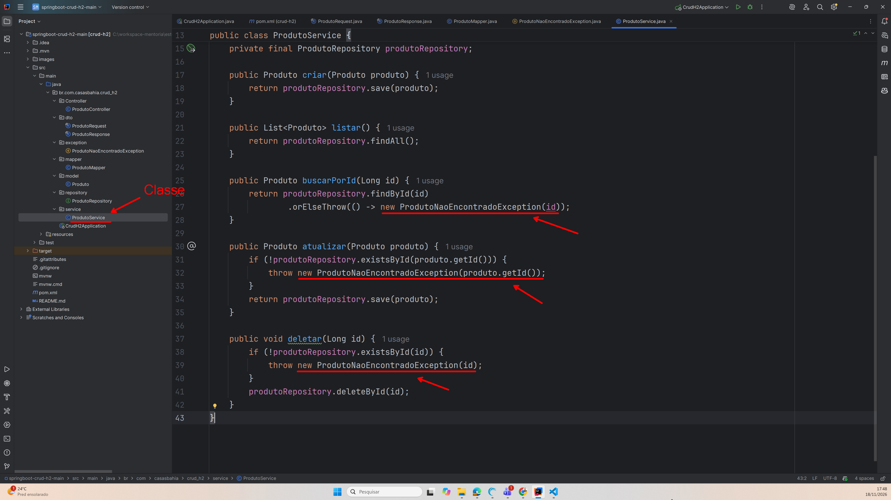


## 6️⃣ Documentando e aprimorando o controller

Vamos documentar o controller de produtos usando as anotações do OpenAPI, a saber:
- `@Tag` agrupa as operações e `@Operation` descreve o que cada uma faz.
- `@ApiResponse` registra o código e a descrição da resposta. A resposta de sucesso com corpo usa o tipo Java do método para gerar seu schema.
- `content = @Content` evita que o schema de sucesso seja associado às respostas de erro. Nesta aula, o contrato registra os status de erro. A estrutura do corpo de erro fica para o exercício complementar.
- `@Parameter` descreve o `id` da URL. `@RequestBody` desserializa o JSON e `@Valid` aciona a validação.


### Aprimorando o controller com o Request e Response DTOs
Para melhorar a manutenção e a clareza do código, vamos utilizar DTOs (Data Transfer Objects) para as requisições e respostas do controller. O `ProdutoRequest` será usado para receber os dados de entrada, enquanto o `ProdutoResponse` será usado para enviar os dados de saída.

Segue o código antigo do controller para buscar um produto por ID:
```java
    @GetMapping("/{id}")
    public ResponseEntity<Produto> buscarPorId(@PathVariable Long id) {
        return ResponseEntity.ok(produtoService.buscarPorId(id));
    }
```

Vamos atualizar o código para utilizar os DTOs:
```java
    @GetMapping("/{id}")
    public ResponseEntity<ProdutoResponse> buscarPorId(@PathVariable Long id) {
        Produto produto = produtoService.buscarPorId(id);
        ProdutoResponse produtoResponse = produtoMapper.toResponse(produto);
        return ResponseEntity.ok(produtoResponse);
    }
```


Agora vamos atualizar o endpoint de criação de produto para utilizar os DTOs `ProdutoRequest` e `ProdutoResponse`.

Código antigo do controller:
```java
    @PostMapping
    public ResponseEntity<Produto> criar(@RequestBody Produto produto) {
        Produto saved = produtoService.criar(produto);
        return ResponseEntity.ok(saved);
    }
```

Código atualizado do controller usando DTOs:
```java
    @PostMapping
    public ResponseEntity<ProdutoResponse> criar(@RequestBody @Valid ProdutoRequest produtoRequest) {
        Produto produto = produtoMapper.toEntity(produtoRequest);
        Produto saved = produtoService.criar(produto);
        ProdutoResponse produtoResponse = produtoMapper.toResponse(saved);
        return ResponseEntity.ok(produtoResponse);
    }
```

Observe que foi utilizado a anotação `@Valid` para acionar a validação do `ProdutoRequest` e o `ProdutoMapper` para converter entre os DTOs e a entidade `Produto`.

Além disso, ao utilizar DTOs, conseguimos controlar melhor quais campos são expostos na API, evitando o vazamento de informações sensíveis da entidade `Produto`.

Dessa forma, o controller não manipula diretamente a entidade `Produto`, mas sim os DTOs, garantindo uma separação clara entre a camada de apresentação e a camada de negócio.


Segue o código completo da classe `Controller/ProdutoController.java` com a implementação dos aprimoramentos utilizando DTOs.

```java
package br.com.casasbahia.crud_h2.Controller;

import br.com.casasbahia.crud_h2.dto.ProdutoRequest;
import br.com.casasbahia.crud_h2.dto.ProdutoResponse;
import br.com.casasbahia.crud_h2.mapper.ProdutoMapper;
import br.com.casasbahia.crud_h2.model.Produto;
import br.com.casasbahia.crud_h2.service.ProdutoService;
import io.swagger.v3.oas.annotations.Operation;
import io.swagger.v3.oas.annotations.Parameter;
import io.swagger.v3.oas.annotations.headers.Header;
import io.swagger.v3.oas.annotations.media.Content;
import io.swagger.v3.oas.annotations.media.Schema;
import io.swagger.v3.oas.annotations.responses.ApiResponse;
import io.swagger.v3.oas.annotations.tags.Tag;
import jakarta.validation.Valid;
import lombok.RequiredArgsConstructor;
import org.springframework.http.ResponseEntity;
import org.springframework.web.bind.annotation.DeleteMapping;
import org.springframework.web.bind.annotation.GetMapping;
import org.springframework.web.bind.annotation.PathVariable;
import org.springframework.web.bind.annotation.PostMapping;
import org.springframework.web.bind.annotation.PutMapping;
import org.springframework.web.bind.annotation.RequestBody;
import org.springframework.web.bind.annotation.RequestMapping;
import org.springframework.web.bind.annotation.RestController;
import org.springframework.web.servlet.support.ServletUriComponentsBuilder;

import java.net.URI;
import java.util.List;

@Tag(name = "Produtos", description = "Operações do cadastro de produtos")
@RestController
@RequestMapping("/api/produtos")
@RequiredArgsConstructor
public class ProdutoController {

    private final ProdutoService produtoService;
    private final ProdutoMapper produtoMapper;

    @Operation(summary = "Cadastrar um produto")
    @ApiResponse(responseCode = "201", description = "Produto cadastrado", useReturnTypeSchema = true,
            headers = @Header(name = "Location", description = "URL do produto cadastrado",
                    schema = @Schema(type = "string", format = "uri")))
    @ApiResponse(responseCode = "400", description = "Requisição inválida", content = @Content)
    @PostMapping
    public ResponseEntity<ProdutoResponse> criar(@Valid @RequestBody ProdutoRequest request) {
        Produto salvo = produtoService.criar(produtoMapper.toEntity(request));
        URI location = ServletUriComponentsBuilder.fromCurrentRequestUri()
                .path("/{id}")
                .buildAndExpand(salvo.getId())
                .toUri();
        return ResponseEntity.created(location).body(produtoMapper.toResponse(salvo));
    }

    @Operation(summary = "Listar os produtos")
    @ApiResponse(responseCode = "200", description = "Lista retornada", useReturnTypeSchema = true)
    @GetMapping
    public List<ProdutoResponse> listar() {
        return produtoService.listar().stream()
                .map(produtoMapper::toResponse)
                .toList();
    }

    @Operation(summary = "Buscar um produto pelo ID")
    @ApiResponse(responseCode = "200", description = "Produto encontrado", useReturnTypeSchema = true)
    @ApiResponse(responseCode = "400", description = "ID ou requisição inválida", content = @Content)
    @ApiResponse(responseCode = "404", description = "Produto não encontrado", content = @Content)
    @GetMapping("/{id}")
    public ProdutoResponse buscarPorId(
            @Parameter(description = "ID do produto", example = "1") @PathVariable("id") Long id) {
        return produtoMapper.toResponse(produtoService.buscarPorId(id));
    }

    @Operation(summary = "Atualizar um produto")
    @ApiResponse(responseCode = "200", description = "Produto atualizado", useReturnTypeSchema = true)
    @ApiResponse(responseCode = "400", description = "Requisição inválida", content = @Content)
    @ApiResponse(responseCode = "404", description = "Produto não encontrado", content = @Content)
    @PutMapping("/{id}")
    public ProdutoResponse atualizar(
            @Parameter(description = "ID do produto", example = "1") @PathVariable("id") Long id,
            @Valid @RequestBody ProdutoRequest request) {
        Produto produto = produtoMapper.toEntity(request);
        produto.setId(id);
        return produtoMapper.toResponse(produtoService.atualizar(produto));
    }

    @Operation(summary = "Excluir um produto")
    @ApiResponse(responseCode = "204", description = "Produto excluído", content = @Content)
    @ApiResponse(responseCode = "400", description = "ID ou requisição inválida", content = @Content)
    @ApiResponse(responseCode = "404", description = "Produto não encontrado", content = @Content)
    @DeleteMapping("/{id}")
    public ResponseEntity<Void> deletar(
            @Parameter(description = "ID do produto", example = "1") @PathVariable("id") Long id) {
        produtoService.deletar(id);
        return ResponseEntity.noContent().build();
    }
}
```

Com essa implementação o POST passa a responder `201 Created` e inclui o cabeçalho `Location` com a URL do produto. No PUT, o ID vem da URL e o corpo representa o estado completo do produto. Envie os campos opcionais que deseja conservar, pois a ausência deles grava `null`.


### Códigos de resposta HTTP

Seguem os principais códigos de resposta HTTP utilizados na API:

| Código | Descrição |
| --- | --- |
| 200 | Requisição bem-sucedida |
| 201 | Recurso criado com sucesso |
| 204 | Recurso excluído com sucesso |
| 400 | Requisição inválida |
| 404 | Recurso não encontrado |

Dessa forma, ao consultar a documentação da API no Swagger UI, você poderá visualizar os códigos de resposta esperados para cada operação.


 
## 7️⃣ Personalizando o cabeçalho da documentação

O bean abaixo configura os metadados exibidos no Swagger UI. A versão `1.0.0` identifica a API e aparece em `info.version`. O campo `openapi` identifica a versão da especificação.

Crie ou substitua `config/OpenApiConfig.java` no pacote base.

```java
package br.com.casasbahia.crud_h2.config;

import io.swagger.v3.oas.models.OpenAPI;
import io.swagger.v3.oas.models.info.Info;
import org.springframework.context.annotation.Bean;
import org.springframework.context.annotation.Configuration;

@Configuration
public class OpenApiConfig {

    @Bean
    public OpenAPI produtosOpenApi() {
        return new OpenAPI().info(new Info()
                .title("API de Produtos")
                .description("CRUD de produtos com Spring Boot e banco H2")
                .version("1.0.0"));
    }
}
```
- Segue a imagem ilustrando o Swagger UI com os metadados personalizados:

    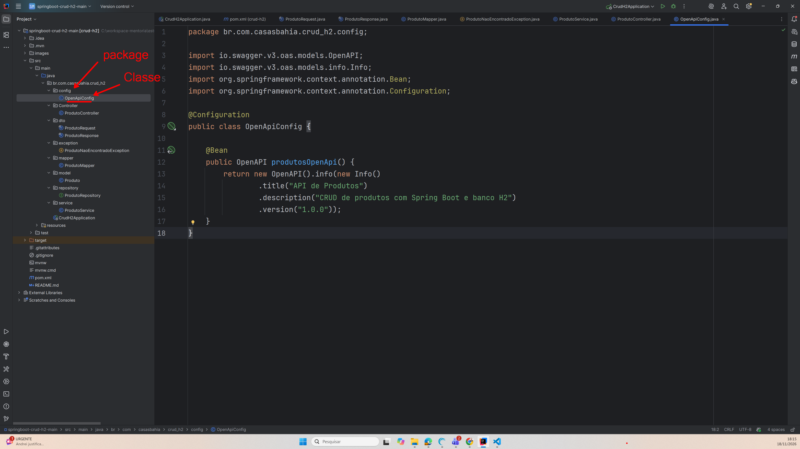


## 8️⃣ Testando o CRUD no Swagger UI

Reinicie `CrudH2Application` no IntelliJ. Abra a primeira URL e expanda o grupo **Produtos**.

| Recurso | Endereço local |
| --- | --- |
| Swagger UI | [localhost:8080/swagger-ui.html](http://localhost:8080/swagger-ui.html) |
| Especificação JSON | [localhost:8080/v3/api-docs](http://localhost:8080/v3/api-docs) |
| Especificação YAML | [localhost:8080/v3/api-docs.yaml](http://localhost:8080/v3/api-docs.yaml) |


- Segue uma imagem ilustrando o Swagger UI com o recurso de criação de produtos:

    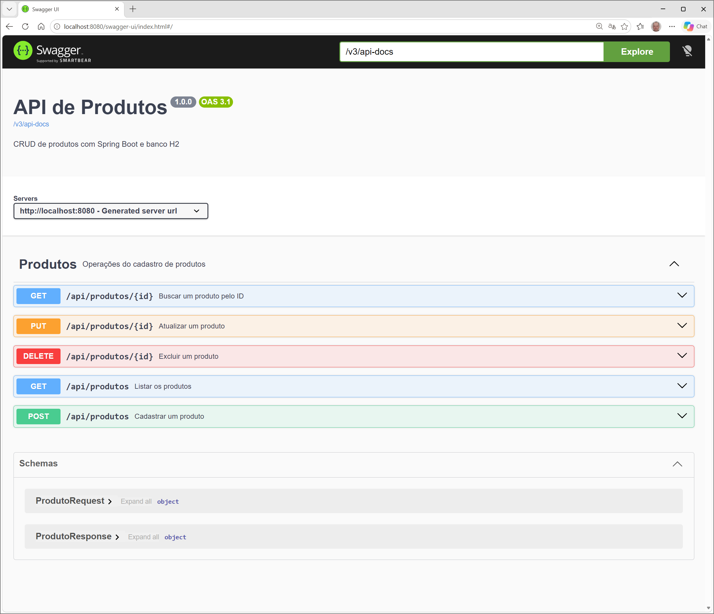


Em **POST /api/produtos**, clique em **Try it out**, cole o JSON e selecione **Execute**.

```json
{
  "nome": "Teclado USB",
  "ncm": "84716052",
  "descricaoNcm": "Teclados",
  "preco": 89.90,
  "quantidade": 12
}
```

- Segue a imagem ilustrando o método POST, ou seja, a criação de um produto no Swagger UI:

    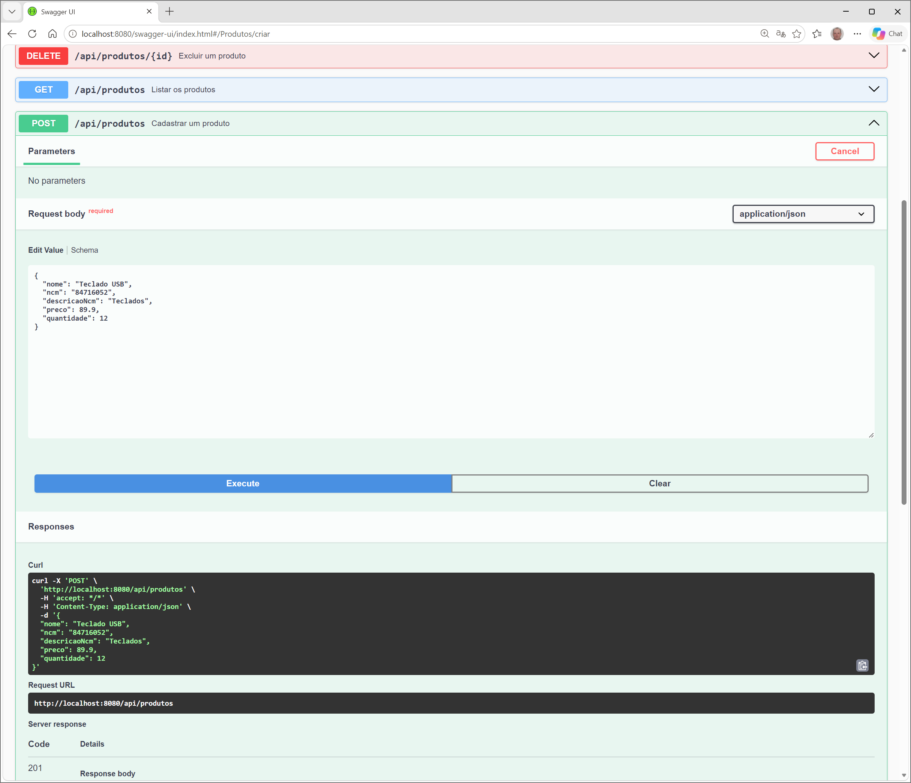


No painel **Server response**, confira o status, copie o `id` do JSON e observe o cabeçalho `Location`. Use esse ID nas etapas seguintes.

- Segue a imagem ilustrando a resposta do servidor após a criação do produto:

    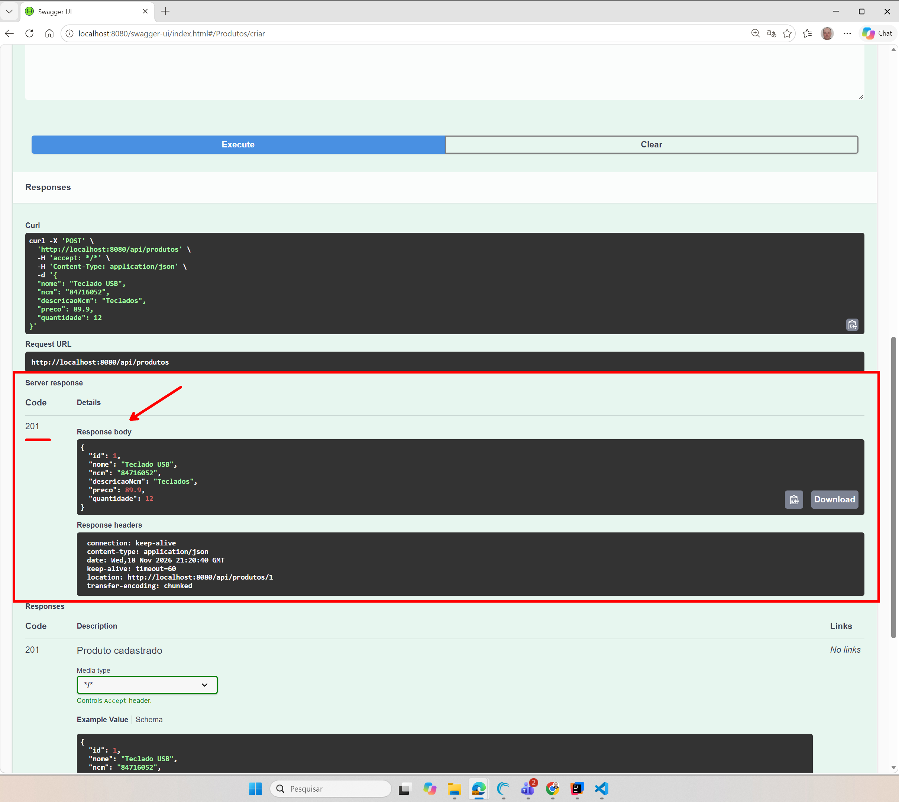


| Ordem | Operação | Resultado esperado |
| --- | --- | --- |
| 1 | Criar com o JSON de exemplo | `201`, cabeçalho `Location` e produto com `id` |
| 2 | Listar produtos | `200` e uma lista contendo o produto |
| 3 | Consultar pelo ID retornado | `200` e o produto correspondente |
| 4 | Atualizar pelo ID usando o mesmo JSON com `quantidade: 20` | `200`, mesmo `id` e quantidade 20 |
| 5 | Excluir pelo ID | `204` sem corpo |
| 6 | Consultar, atualizar ou excluir o ID removido | `404` em cada operação. No PUT, use um corpo válido |
| 7 | Criar com o nome vazio ou preço negativo | `400` |


## 🧪 Estudo complementar

1. Acrescente `@Pattern(regexp = "[0-9]{8}")` ao campo `ncm` de `ProdutoRequest`. Teste oito dígitos, letras e a omissão do campo. Explique por que a omissão continua aceita.
2. Defina um corpo de erro para os status `400` e `404` com `ProblemDetail` e `@RestControllerAdvice`. Documente o schema e compare o JSON real com o contrato gerado.
3. Compare o `ProdutoRequest` do POST com o do PUT. Se a regra do cadastro passar a exigir NCM apenas na criação, modele um DTO para cada operação e verifique a diferença no Swagger UI.

## 📚 Referências

- [Aula 1 · CRUD com Spring Boot](https://github.com/alonsodecarli/springboot-crud-h2)
- [Springdoc OpenAPI · Getting Started](https://springdoc.org/getting-started.html)
- [OpenAPI Specification](https://spec.openapis.org/oas/latest.html)
- [Spring MVC · Validação](https://docs.spring.io/spring-framework/reference/web/webmvc/mvc-controller/ann-validation.html)
